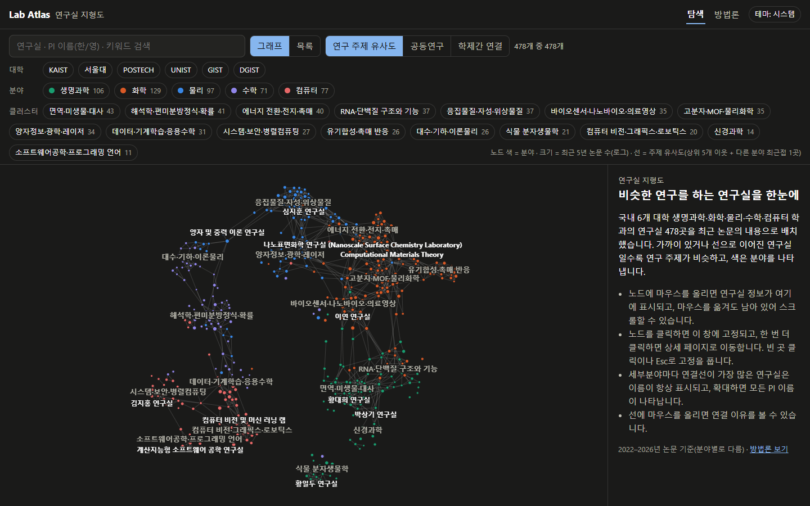
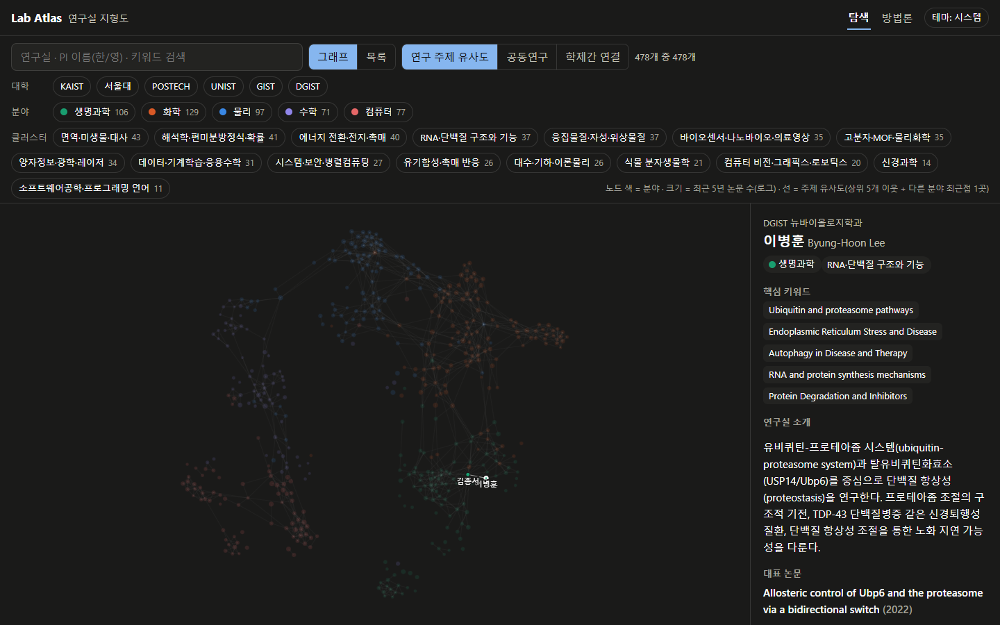
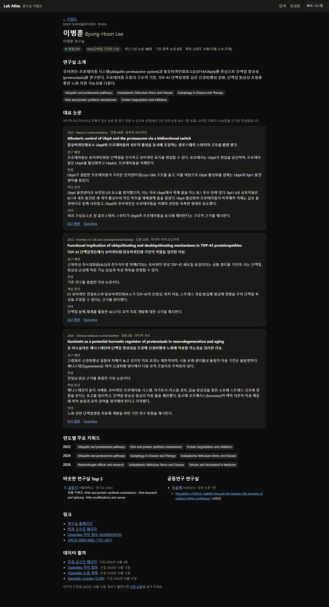
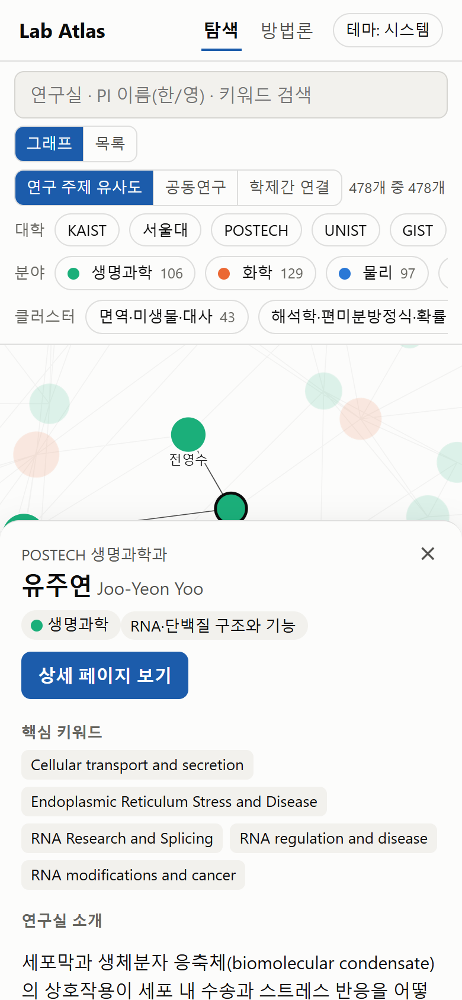

# Lab Atlas · 연구실 지형도

**🔗 라이브 사이트: https://kdwtom.github.io/lab-atlas/**

국내 6개 대학(KAIST·서울대·POSTECH·UNIST·GIST·DGIST)의 **생명과학·화학·물리·수학·컴퓨터** 학과 연구실 **479곳**을
최근 5년 논문 내용으로 배치한 인터랙티브 지도입니다. 대학원 진학을 고민하는 학생이 "내가 관심 있는 연구와 비슷한 연구실은
어디에 있나"를 한눈에 탐색하고 비교할 수 있도록 만들었습니다. 분야가 달라도 연구 내용이 가까우면 가까이 놓이므로
바이오센서·RNA 구조·데이터 과학처럼 여러 분야가 만나는 연구실을 찾을 수 있습니다.

- 노드 하나 = 연구실 하나. 색은 학과 분야, 크기는 최근 5년 논문 수(로그). 세부분야마다 연결이 가장 많은 연구실은 이름을 항상 표시
- 선은 **연구 주제 유사도**(논문 임베딩), **공동연구**(함께 쓴 논문), **학제간 연결**(분야가 다른 연구실 사이) 중 하나로 전환
- **내 후보**: 관심 연구실을 담으면 비슷한 연구실을 이유와 함께 추천하고(다른 분야만 보기 가능), 최대 4곳을 비교표로 나란히 보며 링크로 공유합니다. 서버 없이 브라우저에서 계산합니다
- 연구실마다 한국어 소개(459곳, 쓰지 못한 20곳은 이유 표시), 대표 논문, 연도별 키워드 변화, 비슷한 연구실 Top 5, 출처와 수집 날짜
- 모든 데이터는 공식 교수진 페이지와 OpenAlex·Semantic Scholar API 응답에서만 가져왔고, 확인할 수 없는 항목은 "정보 없음"으로 표시합니다

| 메인 그래프 | 호버 미리보기 |
|---|---|
|  |  |

| 연구실 상세 | 모바일 하단 시트 |
|---|---|
|  |  |

목록 보기, 방법론 페이지, 더미 300노드 성능 테스트 화면은 [docs/screenshots/](docs/screenshots/)에 있습니다.

---

## 범위와 데이터

1단계 확장(2026-10)으로 생명과학 6개 학과에 화학·물리·수학·컴퓨터 21개 학과를 더했습니다. 계획과 진행 기록은 [PLAN_PHASE1.md](PLAN_PHASE1.md)에 있습니다.

| 분야 | 학과 수 | 지형도 연구실 | 선정 기준 (2022–2026) |
|---|---:|---:|---|
| 생명과학 | 6 | 106 | 마지막·교신저자 논문(article·review) 5편 이상 |
| 화학 | 6 | 128 | 마지막·교신저자 논문 5편 이상 |
| 물리 | 6 | 97 | 마지막·교신저자 논문 5편 이상, 저자 100명 이상 대형 협력 논문 제외 |
| 수학 | 5 | 71 | 저자 순서 무관 논문 4편 이상 (알파벳 순 저자 관행) |
| 컴퓨터 | 4 | 77 | 마지막·교신저자 또는 알파벳 순(3인 이상) 논문 5편 이상, 학회 논문 포함, 대형 협력 논문 제외 |
| **합계** | **27** | **479** | |

- **대상 학과**: KAIST 생명과학과·화학과·물리학과·수리과학과·전산학부 / 서울대 생명과학부·화학부·물리천문학부·수리과학부·컴퓨터공학부 / POSTECH 생명과학과·화학과·물리학과·수학과·컴퓨터공학과 / UNIST 생명과학과·화학과·물리학과·수리과학과·컴퓨터공학과 / GIST 생명과학과·화학과·물리·광과학과·수리과학과 / DGIST 뉴바이올로지학과·화학 트랙·물리 트랙. GIST·DGIST의 전기전자컴퓨터공학 학과는 전기전자와 합쳐진 학과라 공학 확장 때 다루기로 했습니다
- **수집**: 교수진 등재 746명 → 전임 719명 → OpenAlex 매칭 588건 → 기준 충족 479곳(겸무 교수 2명은 한 연구실로 합침). 학과별 수치는 [stats.md](pipeline/output/stats.md)
- **결과**: 연구실 479곳, 논문 9,451편, 유사도 연결선 1,249개(그중 분야를 넘는 선 208개), 공동연구 연결선 659개, 클러스터 16개
- **매칭 수동 교정**: 자동 매칭 중 의심 사례 173건의 논문 제목을 사람이 아닌 Claude가 읽고 판단해, 16명을 고쳤습니다(프로필 교체 10명, 제외 6명). 교수진 페이지와 하나하나 대조한 것은 아니므로 오류가 남아 있을 수 있습니다. 내역은 [match_overrides.json](pipeline/curation/match_overrides.json)에 있습니다
- **제외 기록**: 매칭에 실패했거나 기준에 못 미친 교수는 이름·학과·사유·후보 ID와 함께 [pipeline/output/excluded.csv](pipeline/output/excluded.csv)에 남깁니다
- **검증**: 무작위 연구실 10곳 실시간 출처 대조 — 생명과학 [docs/verification.md](docs/verification.md), 1단계 신규 분야 [docs/verification-phase1.md](docs/verification-phase1.md) 모두 소속·OpenAlex 저자·대표 논문·논문 수·링크 10/10 일치. 확장 전후로 생명과학 연구실의 매칭·논문 수가 바뀌지 않았는지 `python -m pipeline.regression <이전 output 폴더>`로 확인합니다

방법론 전체(매칭, 동명이인 처리, 유사도·클러스터링, 대표 논문 선정 규칙, 한계)는 사이트의 **방법론** 페이지(`#/about`)와 [PLAN.md](PLAN.md)에 있습니다.

---

## 실행 방법

필요: Python 3.11+, Node.js 20+. Windows PowerShell 기준이며 `make`는 쓰지 않습니다.

### 사이트만 실행 (데이터는 저장소에 포함)

```powershell
cd web
npm install
npm run dev          # http://localhost:5173
npm run typecheck
npm run build        # 정적 빌드 → web/dist
```

### 검증 (6단계)

```powershell
.\.venv\Scripts\Activate.ps1
python -m pytest pipeline/tests
python -m pipeline.run --stage verify     # 스키마 검증 → 빈 필드 통계 → 깨진 링크 검사 → 무작위 10곳 대조
#   결과: pipeline/output/field_stats.md, pipeline/output/link_report.csv, docs/verification.md
#   링크 검사와 대조는 캐시 없이 실시간으로 요청합니다

cd web
npm run build; npx vite preview --port 4173   # 다른 터미널에서
node scripts/check.mjs                        # 스크린샷(docs/screenshots) + 호버 FPS(실데이터 / 더미 300노드)
```

### 데이터 갱신 (파이프라인 재실행)

```powershell
py -3 -m venv .venv; .\.venv\Scripts\Activate.ps1
pip install -r pipeline\requirements.txt -r pipeline\requirements-ml.txt
copy .env.example .env                     # OPENALEX_MAILTO(필수), OPENALEX_API_KEY·S2_API_KEY(선택)

python -m pipeline.run --stage collect     # 교수진 → OpenAlex 매칭 → 논문 → TLDR → 통계 → 검증
python -m pipeline.run --steps flag        # 동명이인 의심 논문 → output/paper_flags.csv
#   사람이 검토해 제외할 논문을 pipeline/curation/excluded_papers.csv에 사유와 함께 기록한 뒤
python -m pipeline.run --steps papers,tldr,stats
python -m pipeline.run --stage analyze     # SPECTER 임베딩 → 유사도·공동연구·Louvain·UMAP → 검증
python -m pipeline.run --stage export      # 대표 논문 선정 → web/public/data 내보내기 → 검증
```

- 모든 HTTP 응답은 `pipeline/cache/`에 캐시되어 재실행 시 네트워크를 다시 쓰지 않습니다. `--offline`으로 캐시만 사용할 수 있습니다
- 클러스터 라벨은 [pipeline/curation/cluster_labels.json](pipeline/curation/cluster_labels.json)에서 관리하며, 클러스터 키워드가 바뀌면 경고가 나옵니다
- 한국어 요약과 연구실 소개는 `export`가 만든 `pipeline/output/summary_tasks/batch_NN.md`(초록·TLDR)를 근거로 작성해 `pipeline/curation/summaries/batch_NN.json`에 저장합니다. 요약이 없으면 사이트에 "정보 없음"으로 나옵니다
- 갱신한 `web/public/data`를 커밋하고 push하면 GitHub Actions가 배포합니다

### 배포 (GitHub Pages)

[.github/workflows/deploy.yml](.github/workflows/deploy.yml)이 `main` push마다 데이터 스키마 검증 → 타입 검사 → 빌드 → Pages 배포를 실행합니다.
처음 한 번 저장소의 **Settings → Pages → Source**를 "GitHub Actions"로 바꿔 주세요. 방법론 페이지의 "정보 수정 요청" 링크는 빌드 시 저장소 주소(`VITE_REPO_URL`)로 자동 설정됩니다.

---

## 기술적 의사결정

| 결정 | 이유 |
|---|---|
| **정적 사이트 + 빌드 시 고정 JSON** | 런타임 API 호출이 없어 GitHub Pages에서 무료로 호스팅되고, API 한도·장애와 무관하게 동작합니다. 모든 레코드에 출처 URL과 수집 날짜가 남습니다 |
| **HashRouter**, Vite `base: './'` | GitHub Pages는 SPA 라우팅 fallback이 없으므로 `#/lab/:id` 형태로 새로고침·공유 링크가 깨지지 않게 했습니다 |
| **OpenAlex** (Scopus·Google Scholar 대신) | 무료·개방 API, 저자 ID·소속 이력·ORCID·교신저자 여부·주제를 모두 제공해 동명이인 교차 확인이 가능합니다 |
| **엄격한 매칭 후 제외** | 잘못 매칭된 연구실 하나가 사이트 신뢰도를 크게 떨어뜨리므로, 소속 이력·이름 표기·주제·교수진 페이지 대표 논문·ORCID를 교차 확인해 후보가 정확히 한 명일 때만 매칭하고 나머지는 사유와 함께 제외했습니다 |
| **기관 저자 명단 기반 매칭 (1단계)** | OpenAlex는 이름 검색 1회에 10크레딧, 목록 조회 200건에 1크레딧입니다. 대학별 저자 명단(최근 소속 + 논문 5편 이상)을 한 번에 받아 로컬에서 후보를 찾으면 교수 541명 매칭을 하루 한도 안에서 끝낼 수 있습니다. 동명이인이 여럿이면 같은 ORCID 프로필을 합치고, 분야 기준 논문을 실제로 이끄는 후보(다른 후보의 3배 이상)를 고릅니다 |
| **분야별 선정 규칙과 주제 확인** | 저자 순서 관행(수학의 알파벳 순, 컴퓨터의 학회 논문, 물리의 대형 협력 논문)이 달라 한 기준을 그대로 쓰면 분야별로 불공평합니다. 매칭의 주제 확인도 OpenAlex 분야 단위로 해 같은 Physical Sciences 안의 화학자와 컴퓨터과학자를 구분합니다 |
| **학제간 연결 보장** | 전체에서 상위 5개 이웃만 잇으면 선이 거의 같은 분야 안에만 생깁니다. 연구실마다 다른 분야의 최근접 1곳을 같은 임계값으로 더 이어, 바이오정보학 같은 경계 연구가 묻히지 않게 했습니다 |
| **노드 색 = 분야** | 클러스터가 16개로 늘어 8색 팔레트로는 구분할 수 없고, 분야 색이면 한 클러스터 안에 여러 분야가 섞인 학제간 지점이 바로 보입니다. 클러스터는 그래프 위 라벨과 필터로 표시합니다 |
| **동명이인 논문 2단계 정리** | OpenAlex 병합 프로필에 타인의 논문이 섞이는 문제를 (1) 소속 필터, (2) 임베딩 이상치 표시 + 사람 검토로 처리했습니다. 무작위 대조에서 논문 수가 정확히 재현됩니다 |
| **SPECTER 임베딩 + 인용 로그 가중 평균** | 과학 논문 제목·초록에 특화된 모델이라 키워드 일치보다 연구 내용 유사도를 잘 반영하고, CPU에서 돌아갑니다. 인용 가중치는 연구실의 대표 방향을 강조하되 log로 소수 논문의 과도한 영향을 막습니다 |
| **상위 k=5 이웃 + 분위수 임계값** | 모든 쌍을 연결하면 그래프가 털뭉치가 되므로, 연구실마다 가까운 이웃만 남기고 하위 25%는 잘라 선의 의미를 유지했습니다 |
| **Louvain(seed 고정) + UMAP 초기 좌표** | 재실행해도 같은 클러스터·같은 모양이 나오도록 seed를 고정했고, UMAP 좌표를 앵커로 쓰는 약한 힘 덕분에 레이아웃이 매번 같은 지형으로 수렴합니다 |
| **react-force-graph-2d (Canvas)** | SVG보다 노드 수백 개에서 호버가 가볍습니다. 연구실 478곳 실데이터에서 호버 중 약 46fps(헤드리스 측정)를 확인했습니다. 더 늘리려면 WebGL과 좌표 사전 계산이 필요합니다(2단계) |
| **초록 원문 비공개** | 저작권을 고려해 사이트에는 직접 작성한 요약과 DOI 링크만 싣습니다. 검증 단계가 공개 데이터에 `abstract`·`tldr`·이메일이 없는지 검사합니다 |
| **pydantic ↔ TypeScript 1:1 스키마** | 파이프라인의 마지막 단계와 CI에서 스키마·상호 참조를 검증해 프론트엔드가 잘못된 데이터를 받지 않게 했습니다 |
| **접근성** | 그래프는 마우스 전용이므로 키보드로 쓸 수 있는 검색(콤보박스)과 정렬 가능한 목록 표를 함께 제공하고, 텍스트 색 대비는 라이트·다크 모두 WCAG AA(4.5:1 이상)를 충족합니다. 클러스터는 색과 함께 항상 글자 라벨로도 표시합니다 |

---

## 폴더 구조

```
lab-atlas/
├─ pipeline/                 # Python 데이터 파이프라인 (python -m pipeline.run)
│  ├─ departments.yaml       # 대상 학과 레지스트리 (분야, 교수진 페이지, 파서, 매칭 방식)
│  ├─ step01…step10_*.py     # 수집 → 매칭 → 논문 → TLDR → 통계 → 임베딩 → 분석 → 선정 → 내보내기
│  ├─ regression.py          # 확장 전후 생명과학 연구실 결과 비교
│  ├─ validate.py            # pydantic 스키마·상호 참조·공개 규칙 검증
│  ├─ field_stats.py         # 빈 필드 통계
│  ├─ check_links.py         # 깨진 링크 검사 (실시간)
│  ├─ spot_check.py          # 무작위 연구실 출처 대조 (실시간, SPOTCHECK_SCOPE=phase1이면 신규 분야만)
│  ├─ curation/              # 사람이 검토·작성한 입력: 제외 논문, 클러스터 라벨, 요약
│  └─ output/                # 중간 산출물, excluded.csv, 통계
├─ web/                      # Vite + React + TypeScript
│  ├─ public/data/           # labs / papers / edges / clusters / meta .json
│  ├─ src/                   # 그래프, 패널, 목록, 상세·방법론 페이지
│  └─ scripts/check.mjs      # 스크린샷 + 성능 측정 (로컬 Edge, playwright-core)
├─ docs/                     # 스크린샷, 출처 대조 결과
└─ .github/workflows/        # GitHub Pages 배포
```

## 한계

- **논문 요약의 공백이 한쪽에 몰려 있습니다**: 대표 논문 한국어 요약은 1,375편 중 266편만 작성되어 있고, 대부분 생명과학입니다. 나머지는 API 키가 생기면 일괄 생성할 다음 작업입니다. 요약이 없다고 해서 연구 성과가 적다는 뜻이 아니므로 방법론 페이지에 명시했습니다(현황은 데이터에서 자동 계산됩니다)
- **제목 기반 소개**: [2단계](PLAN_PHASE2.md)에서 추가한 소개 369곳은 초록이 아니라 최근 논문 제목과 키워드만 근거로 주제 수준에서 썼습니다. 표본만 점검했습니다
- **소개를 쓰지 못한 20곳**: 논문이 너무 적거나(7곳), 주제가 동떨어져 동명이인 논문이 섞인 것으로 보이는 곳(13곳)입니다. 지도에는 남겨 두고 이유를 표시하며, 논문이 섞인 곳은 추천에서 뺍니다. 소개는 썼지만 동떨어진 논문이 일부 있는 23곳과 함께 목록은 [intro_unavailable.json](pipeline/curation/intro_unavailable.json)에 있습니다
- 동명이인 논문의 사람 검토는 생명과학 연구실에만 했고, 신규 분야는 소속 필터만 적용되어 있습니다
- POSTECH·UNIST는 대학 공식 연구자 검색을 출처로 써서 학과 홈페이지보다 인원이 적을 수 있고, DGIST 화학·물리는 학부 트랙 명단입니다
- 요약과 연구실 소개는 AI 언어 모델(Claude)이 초록·TLDR만을 근거로 작성했고 표본을 원문과 대조해 점검했지만, 오류가 있을 수 있습니다
- OpenAlex의 저자 식별·교신저자 정보 오류가 그대로 반영될 수 있고, 매칭이 불확실한 교수는 지형도에서 빠져 있습니다(excluded.csv)
- 최근 5년 논문 수 기준은 신임 교수에게 불리합니다. 지형도에 없다는 것이 연구 활동이 적다는 뜻은 아닙니다
- 유사도·클러스터는 논문 텍스트 기반 근사치이며 연구실 분위기·모집 계획은 반영하지 않습니다

이 프로젝트는 각 대학·학과와 관계없는 개인 포트폴리오입니다. 교수 사진은 사용하지 않습니다.
